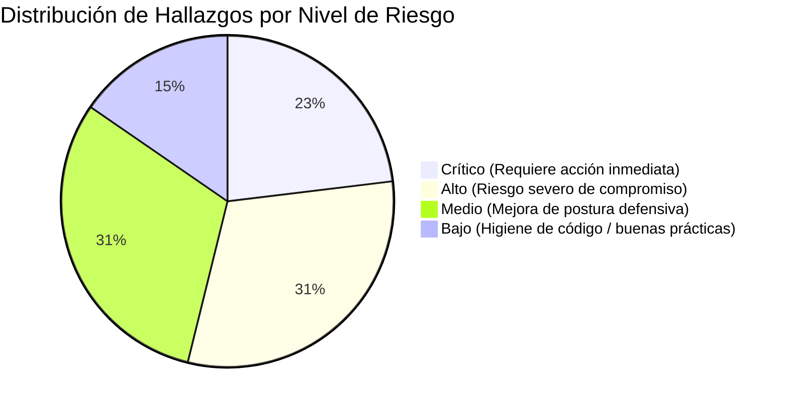

# INFORME DE AUDITORÍA DE SEGURIDAD Y HARDENING DE BASE DE DATOS

**Sistema Auditado:** Sistema de Gestión Documental y Trámites — Concejo Municipal de Sucre (CMS)  
**Motor de Base de Datos:** Microsoft SQL Server 2025 (RTM-GDR) (KB5128492) - 17.0.1145.4 (X64)  
**Base de Datos Activa:** `DB_TRAMITES_EXTERNOS`  
**Entorno de Auditoría:** Local / Desarrollo Institucional  
**Fecha:** 20 de Octubre de 2026  
**Rol Auditor:** DBA Senior & Especialista en Ciberseguridad Defensiva  

---

## 1. Resumen Ejecutivo de Hallazgos

Se realizó una auditoría de seguridad integral y a profundidad cubriendo la configuración de la instancia de base de datos, el esquema relacional, los procedimientos almacenados y la capa de acceso a datos en la API REST (`ASP.NET Core / .NET 8`).



### Matriz de Hallazgos

| ID | Vector | Hallazgo | Severidad | Estado |
| :--- | :--- | :--- | :---: | :---: |
| **SEC-01** | Exposición y Privacidad | Almacenamiento y validación de contraseñas en **Texto Plano** | 🔴 **CRÍTICO** | Vulnerable |
| **SEC-02** | Gestión de Accesos | Uso de la cuenta de superadministrador `sa` en cadenas de conexión | 🔴 **CRÍTICO** | Vulnerable |
| **SEC-03** | Auditoría y Monitoreo | **Cero auditorías activas** a nivel de servidor o base de datos | 🔴 **CRÍTICO** | Vulnerable |
| **SEC-04** | Exposición de Credenciales | Claves JWT y contraseñas SQL hardcodeadas en repositorio git | 🟠 **ALTO** | Vulnerable |
| **SEC-05** | Configuración de Red | Puerto 1433 escuchando en `0.0.0.0` (todas las interfaces de red) | 🟠 **ALTO** | Vulnerable |
| **SEC-06** | Acceso y Tránsito | Conexiones sin cifrado TLS forzado (`Encrypt=False;TrustServerCertificate=True`) | 🟠 **ALTO** | Vulnerable |
| **SEC-07** | Privacidad de Datos | Cifrado en reposo ausente (TDE inactivo) en tablas con PII | 🟠 **ALTO** | Vulnerable |
| **SEC-08** | Control de Acceso | Fallback inseguro de identidad (`userId = 1`) en carga de archivos | 🟡 **MEDIO** | Vulnerable |
| **SEC-09** | Políticas de Acceso | Expiración de contraseña deshabilitada para la cuenta `sa` | 🟡 **MEDIO** | Vulnerable |
| **SEC-10** | Configuración de Servidor | Exposición incondicional de Swagger e información de infraestructura | 🟡 **MEDIO** | Vulnerable |
| **SEC-11** | Privacidad | Almacenamiento de rutas físicas absolutas del servidor en la BD | 🟡 **MEDIO** | Vulnerable |
| **SEC-12** | Consultas SQL | Búsquedas `LIKE` con comodines sin escape de caracteres especiales | 🟢 **BAJO** | Mitigado parcial |

---

## 2. Análisis Detallado por Vector de Seguridad

### Vector 1: Gestión de Accesos y Autenticación
1. **Uso de la cuenta `sa` por la aplicación (SEC-02):**
   - **Evidencia:** `appsettings.json`, `appsettings.Development.json` y el fallback en `Program.cs` contienen `User Id=sa;Password=SqlAdminSucre2026!;`.
   - **Riesgo:** Violación directa del principio de mínimo privilegio (*Least Privilege*). Si la API web es vulnerada o presenta una falla de ejecución de código, el atacante obtiene control total como `sysadmin` sobre el sistema operativo y todas las bases de datos del servidor.
2. **Cifrado en tránsito deshabilitado (SEC-06):**
   - **Evidencia:** Las cadenas de conexión configuran `Encrypt=False` y `TrustServerCertificate=True`.
   - **Riesgo:** Permite ataques de intercepción de tráfico (*Man-in-the-Middle*) en la red local o corporativa, exponiendo credenciales y datos confidenciales de trámites.
3. **Fallback inseguro de autorización (SEC-08):**
   - **Evidencia:** En `AdjuntosController.cs`:
     ```csharp
     var userIdClaim = User.FindFirst("userId")?.Value ?? User.FindFirst(ClaimTypes.NameIdentifier)?.Value;
     int.TryParse(userIdClaim, out int userId);
     if (userId <= 0) userId = 1; // Fallback al usuario administrador
     ```
   - **Riesgo:** Cualquier petición con token anómalo o malformado asume la identidad del Administrador institucional (ID 1).

---

### Vector 2: Vulnerabilidades de Inyección y Consultas (SQLi)
1. **Evaluación de Inyección SQL: Positiva / Seguro:**
   - La arquitectura de acceso a datos en `DB_TRAMITES_EXTERNOS` delega las operaciones a procedimientos almacenados (`usp_Tramites_Listar`, `usp_Usuarios_Autenticar`, `usp_Tramites_ConsultaPublica`, etc.).
   - En la capa C# (`StoredProcedureService.cs`), todas las llamadas emplean colecciones de `SqlParameter` fuertemente tipados.
   - En la base de datos no se identificaron procedimientos que armen cadenas de ejecución dinámica (`EXEC(@sql)` o `sp_executesql`) con entradas de usuario.
2. **Uso de Wildcards en cláusulas LIKE (SEC-12):**
   - **Evidencia:** `t.numero_correlativo LIKE '%' + @Search + '%'`.
   - **Riesgo:** Aunque no permite ejecutar comandos SQL arbitrarios, el no sanitizar caracteres comodín (`%`, `_`, `[`) permite a un atacante alterar los patrones de búsqueda o generar consultas de alto consumo computacional (*Query Exhaustion*).

---

### Vector 3: Exposición y Privacidad de Datos
1. **Contraseñas almacenadas en Texto Plano (SEC-01):**
   - **Evidencia en `AuthService.cs`:**
     ```csharp
     // Comparación directa en texto plano (requerimiento institucional CMS)
     if (!string.IsNullOrEmpty(storedPassword) && (storedPassword == inputPassword || storedPassword == request.Password))
     {
         passwordValid = true;
     }
     ```
     ```csharp
     // Guardar directamente en texto plano sin hash según requerimiento
     string newPassword = request.NewPassword.Trim();
     await _sp.ExecuteNonQueryAsync("dbo.usp_Usuarios_CambiarPassword", ..., new SqlParameter("@PasswordHash", SqlDbType.NVarChar, 255) { Value = newPassword });
     ```
   - **Evidencia en `UsuariosController.cs`:**
     ```csharp
     string? passwordHash = !string.IsNullOrWhiteSpace(dto.Password) ? dto.Password.Trim() : null;
     ```
   - **Riesgo:** Cualquier volcado no autorizado de la tabla `dbo.TEmpleados` expone de forma inmediata las contraseñas de todos los funcionarios y concejales.
2. **Cifrado en reposo ausente (TDE) (SEC-07):**
   - **Evidencia:** La consulta a `sys.dm_database_encryption_keys` arrojó 0 bases cifradas.
   - **Riesgo:** Las tablas `dbo.personas`, `dbo.TEmpleados` y `dbo.tramites` almacenan datos personales sensibles (Cédulas de Identidad, números telefónicos, correos, domicilios y documentos institucionales). Los archivos `.mdf`, `.ldf` y respaldos `.bak` se encuentran en texto binario plano sin cifrado criptográfico.
3. **Exposición de rutas internas del servidor (SEC-11):**
   - **Evidencia:** En `AdjuntosController.cs`, la columna `RutaArchivo` guarda rutas absolutas del servidor (ej. `C:\Users\TEC_DB\...`).

---

### Vector 4: Configuración del Servidor de Base de Datos
1. **Exposición del puerto de red (SEC-05):**
   - **Evidencia:** `netstat -ano` confirmó que SQL Server escucha en `0.0.0.0:1433` y `[::]:1433`.
   - **Riesgo:** El puerto está abierto hacia cualquier interfaz de red local o Wi-Fi sin estar acotado a `127.0.0.1` o restringido por firewall perimetral.
2. **Parámetros CIS evaluados favorablemente:**
   - `xp_cmdshell` = 0 (Deshabilitado).
   - `Ole Automation Procedures` = 0 (Deshabilitado).
   - `cross db ownership chaining` = 0 (Deshabilitado).
   - `clr enabled` = 0 (Deshabilitado).
   - Usuario `guest` sin permiso `CONNECT` en `DB_TRAMITES_EXTERNOS`.

---

### Vector 5: Auditoría, Logging y Monitoreo
1. **Auditoría inactiva a nivel de motor (SEC-03):**
   - **Evidencia:** Consulta a `sys.server_audits` arrojó **0 auditorías**.
   - **Riesgo:** No existe registro forense ante:
     - Intentos fallidos de autenticación (ataques de fuerza bruta).
     - Modificaciones de permisos (`GRANT`, `REVOKE`, `DENY`).
     - Creación, modificación o borrado de objetos (`DROP TABLE`, `ALTER PROCEDURE`).
     - Cambios en membresías de roles de servidor y base de datos.
2. **Fuga de información técnica (SEC-10):**
   - **Evidencia:** `HealthController.cs` expone el nombre del servidor, versión del motor y mensaje detallado de excepciones en respuestas HTTP 500. `Program.cs` expone Swagger en todos los entornos sin restringir a Development.

---

## 3. Plan de Mitigación y Hardening Inmediato

### Paso 1: Creación de Usuario con Mínimo Privilegio (T-SQL)
Ejecutar en SQL Server Management Studio o mediante `sqlcmd`:

```sql
USE [master];
GO

-- 1. Crear Login exclusivo para la API (reemplazar password por uno institucional seguro)
IF NOT EXISTS (SELECT name FROM sys.sql_logins WHERE name = 'usr_tramites_app')
BEGIN
    CREATE LOGIN [usr_tramites_app] 
    WITH PASSWORD = N'App_SecuredPass_Sucre2026!#Strong', 
         CHECK_POLICY = ON, 
         CHECK_EXPIRATION = OFF;
END
GO

USE [DB_TRAMITES_EXTERNOS];
GO

-- 2. Crear usuario de base de datos
IF NOT EXISTS (SELECT name FROM sys.database_principals WHERE name = 'usr_tramites_app')
BEGIN
    CREATE USER [usr_tramites_app] FOR LOGIN [usr_tramites_app];
END
GO

-- 3. Crear rol para ejecución de Stored Procedures
IF NOT EXISTS (SELECT name FROM sys.database_principals WHERE name = 'db_executor' AND type = 'R')
BEGIN
    CREATE ROLE [db_executor];
END
GO

-- 4. Asignar ÚNICAMENTE permiso de ejecución (Principio de Mínimo Privilegio)
GRANT EXECUTE TO [db_executor];
ALTER ROLE [db_executor] ADD MEMBER [usr_tramites_app];

-- 5. Denegar explícitamente alteración de esquema
DENY ALTER TO [usr_tramites_app];
DENY VIEW DEFINITION TO [usr_tramites_app];
GO
```

---

### Paso 2: Actualización de Conexión y Forzado de Cifrado TLS
Modificar `appsettings.json` o definir mediante variables de entorno del sistema operativo:

```json
{
  "ConnectionStrings": {
    "DefaultConnection": "Server=127.0.0.1,1433;Database=DB_TRAMITES_EXTERNOS;User Id=usr_tramites_app;Password=App_SecuredPass_Sucre2026!#Strong;Encrypt=True;TrustServerCertificate=True;MultipleActiveResultSets=True;"
  }
}
```

---

### Paso 3: Corrección Criptográfica en C# (`AuthService.cs`)
Eliminar la comparación y guardado en texto plano, aplicando **BCrypt** de forma obligatoria:

```csharp
// Modificación en AuthService.ChangePasswordAsync:
string hashedPassword = BCrypt.Net.BCrypt.HashPassword(request.NewPassword.Trim(), workFactor: 11);

await _sp.ExecuteNonQueryAsync(
    "dbo.usp_Usuarios_CambiarPassword",
    new SqlParameter("@Id", SqlDbType.Int) { Value = userId },
    new SqlParameter("@PasswordHash", SqlDbType.NVarChar, 255) { Value = hashedPassword }
);
```

```csharp
// Modificación en AuthService.LoginAsync:
bool passwordValid = false;
var storedPassword = user.PasswordHash?.Trim();

if (!string.IsNullOrEmpty(storedPassword))
{
    // Solo verificar mediante hash criptográfico
    try
    {
        passwordValid = BCrypt.Net.BCrypt.Verify(request.Password, storedPassword);
    }
    catch
    {
        passwordValid = false;
    }
}
```

---

### Paso 4: Habilitar SQL Server Audit a Nivel de Servidor (T-SQL)
Ejecutar para activar el registro inmutable de eventos críticos:

```sql
USE [master];
GO

-- 1. Crear especificación de auditoría hacia archivo local protegido
CREATE SERVER AUDIT [Auditoria_Seguridad_Instancia]
TO FILE 
(
    FILEPATH = N'C:\Program Files\Microsoft SQL Server\MSSQL17.MSSQLSERVER\MSSQL\Log\',
    MAXSIZE = 100 MB,
    MAX_ROLLOVER_FILES = 10,
    RESERVE_DISK_SPACE = OFF
)
WITH (QUEUE_DELAY = 1000, ON_FAILURE = CONTINUE);
GO

-- 2. Registrar eventos de accesos y modificaciones de privilegios
CREATE SERVER AUDIT SPECIFICATION [Auditoria_Eventos_Criticos]
FOR SERVER AUDIT [Auditoria_Seguridad_Instancia]
    ADD (FAILED_LOGIN_GROUP),
    ADD (SUCCESSFUL_LOGIN_GROUP),
    ADD (APPLICATION_ROLE_CHANGE_PASSWORD_GROUP),
    ADD (SERVER_ROLE_MEMBER_CHANGE_GROUP),
    ADD (DATABASE_ROLE_MEMBER_CHANGE_GROUP),
    ADD (SCHEMA_OBJECT_CHANGE_GROUP);
GO

-- 3. Activar la auditoría
ALTER SERVER AUDIT [Auditoria_Seguridad_Instancia] WITH (STATE = ON);
ALTER SERVER AUDIT SPECIFICATION [Auditoria_Eventos_Criticos] WITH (STATE = ON);
GO
```

---

## 4. Checklist para el Despliegue en Servidores de Producción

Para completar el endurecimiento en los servidores finales de la institución, se deben validar los siguientes aspectos de infraestructura:

1. [ ] **Directorio Activo Institucional:** Si el servidor de BD pertenece al dominio del Concejo Municipal de Sucre, migrar la autenticación de la API a **Windows Authentication (Kerberos)** para prescindir de contraseñas en archivos JSON.
2. [ ] **Certificado SSL/TLS Oficial:** Instalar un certificado firmado por la CA institucional en SQL Server Configuration Manager y activar la directiva `Force Encryption = Yes`.
3. [ ] **Segmentación de Red y Firewall:** Configurar Windows Defender Firewall para que el puerto TCP 1433 admita paquetes entrantes **únicamente** desde la IP estática del servidor de aplicaciones backend.
4. [ ] **Variables de Entorno para Secretos:** Extraer la clave JWT y las contraseñas de `appsettings.json` hacia variables de entorno seguras del sistema operativo o Azure Key Vault / HashiCorp Vault.
5. [ ] **Protección de Backups:** Programar el respaldo de base de datos con compresión y clave de cifrado mediante `BACKUP DATABASE ... WITH ENCRYPTION`.
