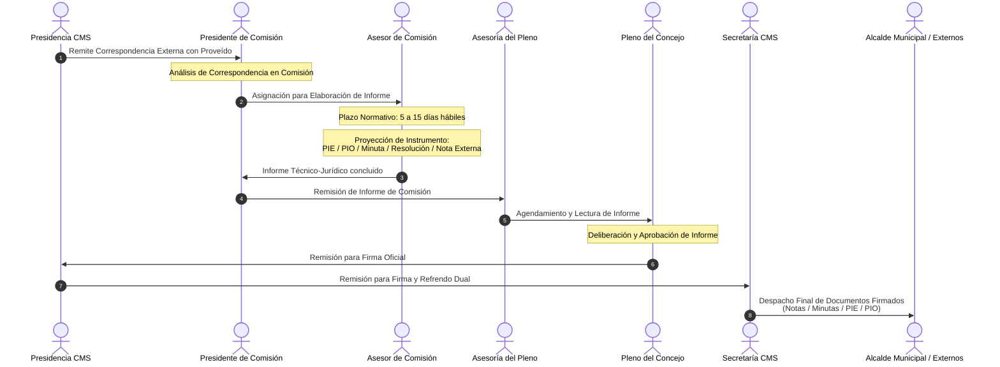

# REQUERIMIENTOS TÉCNICOS Y FUNCIONALES — SISTEMA WAYKA MVP

> **Documento de Análisis** — Extraído de los 4 manuales funcionales del sistema legado Wayka
> **Fecha de análisis:** 28 de agosto de 2026
> **Objetivo:** Servir como contexto base para la reconstrucción del sistema desde cero
> **Alcance:** MVP desarrollado por **un solo programador** en un periodo de **3 meses**

---

## 1. RESUMEN EJECUTIVO Y OBJETIVO DEL SISTEMA

### 1.1 ¿Qué es Wayka?

**Wayka** (del Aymara: "reunirse comunitariamente para atacar el trabajo") es un **Sistema de Gestión de Trámites Documentales y Workflow** diseñado para modelar, ejecutar, supervisar y coordinar flujos de trabajo institucionales de forma electrónica.

### 1.2 Problema que resuelve

Las instituciones gestionan trámites y correspondencias de forma manual (papel físico), generando:

- Pérdida de trazabilidad del documento
- Demoras no controladas en la atención
- Imposibilidad de consultar el estado de un trámite en tiempo real
- Falta de métricas de desempeño por funcionario u oficina

### 1.3 Objetivo del sistema

| Aspecto                   | Descripción                                                                                                           |
| ------------------------- | ---------------------------------------------------------------------------------------------------------------------- |
| **Automatización** | Digitalizar la secuencia de acciones/tareas de los flujos de trabajo institucionales                                   |
| **Monitoreo**       | Permitir supervisar el estado de cada trámite, quién lo tiene, cuánto tiempo lleva                                  |
| **Transparencia**   | Los ciudadanos/clientes pueden consultar el estado de su trámite con el número de Hoja de Ruta                       |
| **Reportería**     | Generar reportes de procesos iniciados, en flujo, concluidos, pendientes por funcionario, etc.                         |
| **Trazabilidad**    | Mantener un historial inmutable de cada actividad: responsable, tiempo estimado vs. transcurrido, proveídos, adjuntos |

### 1.4 Alcance del MVP

El MVP debe cubrir el **ciclo de vida completo de un trámite/correspondencia**, desde su recepción en Ventanilla Única hasta su conclusión o archivo, incluyendo:

- ✅ Autenticación y autorización por roles (JWT)
- ✅ Recepción y registro de trámites en Ventanilla Única
- ✅ Escritorio Virtual con bandejas de pendientes
- ✅ Derivación (avanzar/retroceder) entre funcionarios
- ✅ Registro de proveídos en cada paso
- ✅ Adjuntar/descargar documentos PDF
- ✅ Hoja de Ruta con correlativo automático
- ✅ Búsqueda pública de trámites por número de Hoja de Ruta
- ✅ Reportes básicos de transparencia
- ✅ Bloqueo/desbloqueo de trámites
- ✅ Gestión unificada de Trámites y Correspondencias en un solo flujo directo (derivación libre a destinatario)

**Fuera del alcance del MVP (Fase 2+):**

- ❌ Diseñador visual de flujos de trabajo (actividades, formularios dinámicos, dominios, ACLs)
- ❌ Menús y Enlaces dinámicos gestionados desde base de datos (se usarán rutas fijas en React)
- ❌ Gateway para integración con módulos externos
- ❌ Grupos de trabajo (murales, hilos, segmentos)
- ❌ Análisis y explotación dinámica de datos (reportes con agrupación/conteo por campos)
- ❌ DibRap (generador ABM de tablas genéricas)

---

## 2. MATRIZ DE ROLES Y PERMISOS DE ACCESO

### 2.1 Roles del sistema

El sistema define **5 roles** principales. Para el MVP se implementan **4 roles** (se excluye Diseñador):

| # | Rol                                            | Ámbito en el MVP | Descripción funcional                                                                                                                                                                                                         |
| - | ---------------------------------------------- | ----------------- | ------------------------------------------------------------------------------------------------------------------------------------------------------------------------------------------------------------------------------ |
| 1 | **Administrador de Sistema**             | ✅ Sí            | Gestión de usuarios, roles, personas, organigrama (ubicaciones orgánicas), parámetros del sistema. CRUD completo de entidades base.                                                                                         |
| 2 | **Administrador de Wayka**               | ✅ Sí            | Gestión operativa de trámites: anular, habilitar trámites concluidos, redireccionar procesos de un usuario a otro, administrar tipos correlativos, reportes de transparencia completos.                                     |
| 3 | **Ventanilla Única**                    | ✅ Sí            | Crear/iniciar trámites y correspondencias, registrar datos del formulario, generar Hoja de Ruta, adjuntar documentos, avanzar/retroceder procesos, bloquear/desbloquear trámites. Acceso a su escritorio virtual y reportes. |
| 4 | **Funcionario (Atención de trámites)** | ✅ Sí            | Recibir trámites/correspondencias en su escritorio virtual, atender (registrar proveído), adjuntar documentos, avanzar/retroceder al siguiente paso del flujo. Consultas y reportes de sus trámites.                        |
| 5 | **Diseñador de Wayka**                  | ❌ MVP            | Diseño de procesos, actividades, formularios, campos, dominios, informes, ACLs. Se preconfigura en la DB.                                                                                                                     |

### 2.2 Matriz de permisos por módulo

| Módulo/Funcionalidad                       | Admin Sistema | Admin Wayka | Ventanilla Única | Funcionario |
| ------------------------------------------- | :-----------: | :----------: | :---------------: | :---------: |
| **Gestión de usuarios y roles**      |    ✅ CRUD    |      ❌      |        ❌        |     ❌     |
| **Gestión de personas**              |    ✅ CRUD    |      ❌      |        ❌        |     ❌     |
| **Gestión ubicaciones orgánicas**   |    ✅ CRUD    |      ❌      |        ❌        |     ❌     |
| **Parámetros del sistema**           |    ✅ CRUD    |      ❌      |        ❌        |     ❌     |
| **Tipos correlativos**                |      ❌      | ✅ Modificar |        ❌        |     ❌     |
| **Anular trámite**                   |      ❌      |      ✅      |        ❌        |     ❌     |
| **Habilitar trámite concluido**      |      ❌      |      ✅      |        ❌        |     ❌     |
| **Redireccionar trámite**            |      ❌      |      ✅      |        ❌        |     ❌     |
| **Crear/iniciar trámite**            |      ❌      |      ❌      |        ✅        |     ❌     |
| **Recepción correspondencia**        |      ❌      |      ❌      |        ✅        |     ❌     |
| **Escritorio Virtual (pendientes)**   |      ❌      |    ✅ Ver    |        ✅        |     ✅     |
| **Atender trámite (proveído)**      |      ❌      |      ❌      |        ✅        |     ✅     |
| **Avanzar trámite**                  |      ❌      |      ❌      |        ✅        |     ✅     |
| **Retroceder trámite**               |      ❌      |      ❌      |        ✅        |     ✅     |
| **Adjuntar documentos**               |      ❌      |      ❌      |        ✅        |     ✅     |
| **Bloquear/Desbloquear**              |      ❌      |      ❌      |        ✅        |     ❌     |
| **Búsqueda pública (Hoja de Ruta)** |      ✅      |      ✅      |        ✅        |     ✅     |
| **Reportes transparencia**            |      ❌      | ✅ Completo |    ✅ Limitado    | ✅ Limitado |
| **Cambio de clave**                   |      ✅      |      ✅      |        ✅        |     ✅     |

### 2.3 Reglas de asignación de roles

- Un usuario puede tener **múltiples roles** asignados simultáneamente.
- Cada asignación usuario-rol incluye:
  - **Ubicación orgánica** (oficina/unidad a la que pertenece)
  - **Nivel de acceso** (ej: "Control total")
  - **Fecha de expiración** del acceso
  - **Filtro** opcional (para restringir vistas por parámetro)
- Al iniciar sesión, el sistema muestra el usuario, su rol activo y las categorías/enlaces disponibles para ese rol.

---

## 3. CICLO DE VIDA DEL TRÁMITE Y MÁQUINA DE ESTADOS

### 3.1 Estados del trámite

El sistema maneja los siguientes **8 estados** para un proceso de negocio (trámite/correspondencia):

| # | Estado                                           | Código sugerido | Icono/Color | Descripción                                                                                    |
| - | ------------------------------------------------ | ---------------- | ----------- | ----------------------------------------------------------------------------------------------- |
| 1 | **En atención**                           | `EN_ATENCION`  | 🟡          | El trámite está siendo atendido activamente por un funcionario en su oficina                  |
| 2 | **Atendido (listo para despachar)**        | `ATENDIDO`     | 🟢          | El funcionario terminó de atender y el trámite está listo para ser enviado al siguiente paso |
| 3 | **En tránsito**                           | `EN_TRANSITO`  | 🔵          | Digitalmente ya se envió, pero físicamente el documento aún no llegó al destinatario        |
| 4 | **Por recibir (despachado sin confirmar)** | `POR_RECIBIR`  | 🟠          | Fue despachado al siguiente usuario, pero éste aún no lo recepcionó/confirmó                |
| 5 | **Recibido (despachado y en atención)**   | `RECIBIDO`     | 🟡          | Fue despachado y el siguiente usuario ya está atendiéndolo                                    |
| 6 | **Bloqueado**                              | `BLOQUEADO`    | 🔴          | El trámite fue bloqueado temporalmente (por observaciones, documentación incompleta, etc.)    |
| 7 | **Concluido**                              | `CONCLUIDO`    | ⚪          | El proceso de negocio ha terminado su flujo completo                                            |
| 8 | **Anulado**                                | `ANULADO`      | ⛔          | El trámite fue eliminado/anulado por el Administrador de Wayka                                 |

### 3.2 Diagrama de transición de estados

```
                    ┌──────────────┐
                    │   CREADO     │ (Ventanilla Única registra el trámite)
                    └──────┬───────┘
                           │ iniciar
                           ▼
                    ┌──────────────┐
             ┌─────│ EN_ATENCION  │◄────────────────────────────┐
             │     └──────┬───────┘                             │
             │            │ despachar                           │
             │            ▼                                     │
             │     ┌──────────────┐                             │
             │     │  POR_RECIBIR │ (en tránsito digital)       │
             │     └──────┬───────┘                             │
             │            │ recepcionar                         │
             │            ▼                                     │
             │     ┌──────────────┐                             │
             │     │  EN_ATENCION │ (siguiente funcionario)     │
             │     └──────┬───────┘                             │
             │            │                                     │
             │            ├── despachar ──► POR_RECIBIR ──►...  │ (ciclo)
             │            │                                     │
             │            ├── retroceder ──────────────────────►│
             │            │                                     │
             │            │ fin de flujo                        │
             │            ▼                                     │
             │     ┌──────────────┐                             │
             │     │  CONCLUIDO   │                             │
             │     └──────────────┘                             │
             │            ▲                                     │
             │            │ habilitar (Admin Wayka)             │
             │            ▼                                     │
             │     ┌──────────────┐                             │
             │     │  ANULADO     │ (Admin Wayka)               │
             │     └──────────────┘                             │
             │                                                  │
             │ bloquear (Ventanilla)                            │
             ▼                                                  │
      ┌──────────────┐                                          │
      │  BLOQUEADO   │── desbloquear (Ventanilla) ─────────────►│
      └──────────────┘
```

### 3.3 Transiciones permitidas por rol

| Transición                                      | Admin Wayka | Ventanilla Única | Funcionario |
| ------------------------------------------------ | :---------: | :---------------: | :---------: |
| CREADO → EN_ATENCION                            |     ❌     |        ✅        |     ❌     |
| EN_ATENCION → POR_RECIBIR (avanzar)             |     ❌     |        ✅        |     ✅     |
| POR_RECIBIR → EN_ATENCION (recepcionar)         |     ❌     |        ✅        |     ✅     |
| EN_ATENCION → EN_ATENCION anterior (retroceder) |     ❌     |        ✅        |     ✅     |
| EN_ATENCION → CONCLUIDO (fin de flujo)          |     ❌     |        ✅        |     ✅     |
| EN_ATENCION → BLOQUEADO                         |     ❌     |        ✅        |     ❌     |
| BLOQUEADO → EN_ATENCION                         |     ❌     |        ✅        |     ❌     |
| EN_ATENCION → ANULADO                           |     ✅     |        ❌        |     ❌     |
| CONCLUIDO → EN_ATENCION (habilitar)             |     ✅     |        ❌        |     ❌     |
| Redireccionar a otro usuario                     |     ✅     |        ❌        |     ❌     |

### 3.4 Tipos de flujo

El sistema consolida el motor de **Trámites y Correspondencias en un solo flujo directo**, caracterizado por la **derivación libre a destinatario**. Esto simplifica el modelo original de Wayka:

- No existen secuencias predefinidas estrictas para los procesos.
- En cada paso del ciclo, el usuario tiene la libertad de elegir a qué destinatario(s) avanzar el proceso, unificando la experiencia de trámites y correspondencias.

### 3.5 Tipos de actuación en actividades

| Tipo                   | Descripción                                                                    | Implementación MVP |
| ---------------------- | ------------------------------------------------------------------------------- | ------------------- |
| **Lineal**       | El trámite avanza secuencialmente de una actividad a la siguiente              | ✅ Prioridad        |
| **Salto**        | El trámite puede saltar a una actividad no contigua del flujo                  | ⚠️ Fase 2         |
| **Bifurcación** | El flujo se divide en caminos según una decisión (ej: Aprobado / No Aprobado) | ⚠️ Fase 2         |

---

## 4. REQUERIMIENTOS FUNCIONALES CLAVE

### 4.1 RF-01: Autenticación y Gestión de Sesión

| ID      | Requerimiento                                                                            | Prioridad |
| ------- | ---------------------------------------------------------------------------------------- | --------- |
| RF-01.1 | Login con usuario y clave (PIN). Mínimo 6, máximo 10 caracteres                        | ALTA      |
| RF-01.2 | Al autenticarse, mostrar: nombre usuario, rol activo, menú según permisos del rol      | ALTA      |
| RF-01.3 | Cambio de clave: solicitar clave actual, validar, permitir nueva clave con confirmación | ALTA      |
| RF-01.4 | Cerrar sesión desde cualquier pantalla (enlace en esquina superior derecha)             | ALTA      |
| RF-01.5 | Las claves deben almacenarse encriptadas                                                 | ALTA      |
| RF-01.6 | Validar fecha de expiración del usuario-rol al autenticarse                             | MEDIA     |

**Reglas de negocio:**

- Clave mínima: 6 caracteres, máxima: 10 caracteres
- Caracteres válidos: [a-z], [A-Z], [0-9]
- No usar palabras del diccionario ni nombres propios
- Combinar letras con números

### 4.2 RF-02: Gestión de Usuarios, Roles y Organigrama (Admin Sistema)

| ID       | Requerimiento                                                                                                     | Prioridad |
| -------- | ----------------------------------------------------------------------------------------------------------------- | --------- |
| RF-02.1  | CRUD de**Personas**: nombre, apellidos, CI, sexo, estado civil, teléfono, email, empresa telefónica       | ALTA      |
| RF-02.2  | CRUD de**Usuarios**: vinculado a persona, con usuario (login) y clave                                       | ALTA      |
| RF-02.3  | CRUD de**Roles**: nombre del rol, descripción                                                              | ALTA      |
| RF-02.4  | Asignar**usuario-rol**: usuario + rol + ubicación orgánica + nivel de acceso + fecha expiración + filtro | ALTA      |
| RF-02.5  | Un usuario puede tener**múltiples roles**                                                                  | ALTA      |
| RF-02.6  | CRUD de**Ubicaciones orgánicas** (áreas): jerárquica (padre-hijo), con código, nivel                    | ALTA      |
| RF-02.7  | [FUERA DE ALCANCE] Menús dinámicos y enlaces. Se usarán rutas fijas en React                                   | N/A       |
| RF-02.8  | [FUERA DE ALCANCE] Asignación de menús a roles. Controlado por rutas fijas                                      | N/A       |
| RF-02.9  | No permitir eliminar registros con dependencias (mostrar error)                                                   | ALTA      |
| RF-02.10 | Todas las eliminaciones son**borrado lógico**                                                              | ALTA      |

### 4.3 RF-03: Recepción en Ventanilla Única

| ID      | Requerimiento                                                                                                                                      | Prioridad |
| ------- | -------------------------------------------------------------------------------------------------------------------------------------------------- | --------- |
| RF-03.1 | El usuario Ventanilla Única puede crear un nuevo trámite seleccionando el**tipo de proceso** desde una lista desplegable                   | ALTA      |
| RF-03.2 | Al crear, se despliega el formulario del proceso con los campos configurados para registrar los datos                                              | ALTA      |
| RF-03.3 | Generar automáticamente el**número correlativo** (Hoja de Ruta) con el formato: `[CÓDIGO]-[CORRELATIVO]/[GESTIÓN]` (ej: `SV-3/2008`) | ALTA      |
| RF-03.4 | Registrar fecha y hora de creación automáticamente                                                                                               | ALTA      |
| RF-03.5 | Permitir registrar un**proveído** inicial al crear el trámite                                                                              | ALTA      |
| RF-03.6 | Permitir**adjuntar archivos** (múltiples) al momento de la creación                                                                        | ALTA      |
| RF-03.7 | Generar e imprimir la**Hoja de Ruta** en formato institucional                                                                               | ALTA      |

**Para el flujo unificado (Trámites y Correspondencias):**

| ID       | Requerimiento                                                                                                                                                                                                                       | Prioridad |
| -------- | ----------------------------------------------------------------------------------------------------------------------------------------------------------------------------------------------------------------------------------- | --------- |
| RF-03.8  | Registrar proceso unificado: destinatario principal, fecha, hora, nro. hojas/anexos, tipo, referencia                                                                                                                               | ALTA      |
| RF-03.9  | Permitir seleccionar**otros destinatarios** adicionales (múltiples) para la derivación libre                                                                                                                                | ALTA      |
| RF-03.10 | Generar Hoja de Ruta unificada con formato institucional, incluyendo: nro. cite, gestión, tipo, remitente, referencia, primer destinatario                                                                                         | ALTA      |
| RF-03.11 | En trámites externos y correspondencias (`CM`, `Contratos`, `Convenios`), permitir seleccionar la Unidad Destino (`TUnidad`), el Cargo (`TCargo`) y el Funcionario (`TEmpleados`) desde los catálogos institucionales | ALTA      |
| RF-03.12 | Enlace con padrón institucional: permitir buscar y autocompletar funcionarios desde`TEmpleados` por CI tanto en creación de personas como en emisión de hojas de ruta                                                          | ALTA      |

### 4.4 RF-04: Escritorio Virtual y Bandejas

| ID      | Requerimiento                                                                                                                                                                                  | Prioridad |
| ------- | ---------------------------------------------------------------------------------------------------------------------------------------------------------------------------------------------- | --------- |
| RF-04.1 | Cada usuario tiene un**escritorio virtual** que muestra sus trámites/correspondencias pendientes                                                                                        | ALTA      |
| RF-04.2 | El escritorio muestra pestañas/filtros por:**Trámites Recibidos**, **Trámites Despachados**, **Correspondencias Recibidas**, **Correspondencias Despachadas**       | ALTA      |
| RF-04.3 | En**Trámites Recibidos** mostrar estados: atendido y por recibir                                                                                                                        | ALTA      |
| RF-04.4 | En**Trámites Despachados** mostrar estados: despachado sin confirmación y despachado confirmado                                                                                        | ALTA      |
| RF-04.5 | Cada fila del listado muestra: nro. trámite, remitente, referencias (campos marcados como REFS), actividad actual, y opciones de**Formulario**, **Retroceder**, **Avanzar** | ALTA      |
| RF-04.6 | Permitir**filtrar** por número de trámite                                                                                                                                              | ALTA      |
| RF-04.7 | Vista de**pendientes agrupados**: resumen semanal (calendario) con conteo por estado (atendido, por recibir, etc.)                                                                       | MEDIA     |
| RF-04.8 | Las correspondencias vencidas (fecha de respuesta pasada) se muestran en**color rojo**                                                                                                   | MEDIA     |

### 4.5 RF-05: Derivación (Avanzar y Retroceder)

| ID      | Requerimiento                                                                                                                           | Prioridad |
| ------- | --------------------------------------------------------------------------------------------------------------------------------------- | --------- |
| RF-05.1 | **Avanzar** un trámite: despachar al siguiente destinatario según el flujo definido                                             | ALTA      |
| RF-05.2 | Si el flujo es**lineal o salto**: el avance es directo al presionar "Avanzar"                                                     | ALTA      |
| RF-05.3 | Si el flujo tiene**bifurcación**: se presenta una pantalla intermedia para elegir el camino (ej: "Aprobado" / "Sin aprobación") | MEDIA     |
| RF-05.4 | **Retroceder** un trámite: devolver a la actividad anterior del flujo                                                            | ALTA      |
| RF-05.5 | Al retroceder, es**obligatorio** registrar una justificación/razón del retroceso                                                | ALTA      |
| RF-05.6 | Para correspondencias: al avanzar, el usuario elige el destinatario de una lista de funcionarios                                        | ALTA      |
| RF-05.7 | Una correspondencia se puede**archivar** (equivale a concluir)                                                                    | MEDIA     |

### 4.6 RF-06: Proveídos

| ID      | Requerimiento                                                                                                                        | Prioridad |
| ------- | ------------------------------------------------------------------------------------------------------------------------------------ | --------- |
| RF-06.1 | En cada actividad/paso, el usuario puede registrar un**proveído** (texto libre)                                               | ALTA      |
| RF-06.2 | Se muestra un**historial de proveídos** ordenado cronológicamente, con: remitente, cargo, unidad, fecha, texto del proveído | ALTA      |
| RF-06.3 | Para correspondencias, se registra además: instrucción, importancia, fecha de respuesta                                            | MEDIA     |
| RF-06.4 | Los proveídos son**inmutables** una vez registrados (no se pueden editar ni eliminar)                                         | ALTA      |

### 4.7 RF-07: Adjuntos (Documentos PDF)

| ID      | Requerimiento                                                                   | Prioridad |
| ------- | ------------------------------------------------------------------------------- | --------- |
| RF-07.1 | Permitir**adjuntar múltiples archivos** en cada actividad del trámite   | ALTA      |
| RF-07.2 | Mostrar lista de archivos adjuntos con nombre del archivo y opción de descarga | ALTA      |
| RF-07.3 | Permitir**eliminar** adjuntos (borrado lógico)                           | MEDIA     |
| RF-07.4 | Soportar al menos formato**PDF** como tipo principal de adjunto           | ALTA      |
| RF-07.5 | Mostrar confirmación cuando los archivos se adjuntan correctamente             | MEDIA     |

### 4.8 RF-08: Hoja de Ruta y Trazabilidad

| ID      | Requerimiento                                                                                                                                    | Prioridad |
| ------- | ------------------------------------------------------------------------------------------------------------------------------------------------ | --------- |
| RF-08.1 | Cada trámite genera una**Hoja de Ruta** imprimible con formato institucional configurable                                                 | ALTA      |
| RF-08.2 | La Hoja de Ruta incluye: nro. correlativo, gestión, fecha, hora, tipo de proceso, remitente, referencia, nro. hojas/anexos, primer destinatario | ALTA      |
| RF-08.3 | Generar un**listado del proceso** con: nro. hoja de ruta, referencias, actividad, fecha, campo para firma                                  | ALTA      |
| RF-08.4 | Opción de exportar/ver la Hoja de Ruta en**formato PDF**                                                                                  | MEDIA     |

**Trazabilidad (Detalle histórico del proceso):**

| ID      | Requerimiento                                                                                                                                                                                                    | Prioridad |
| ------- | ---------------------------------------------------------------------------------------------------------------------------------------------------------------------------------------------------------------- | --------- |
| RF-08.5 | Mantener un**detalle histórico** inmutable por cada trámite, registrando por cada actividad: actividad, responsable (nombre + cargo + unidad), tiempo estimado, tiempo transcurrido, proveído, adjuntos | ALTA      |
| RF-08.6 | Mostrar**gráfica del flujo**: actividades concluidas (azul) y actividades pendientes (naranja)                                                                                                            | MEDIA     |
| RF-08.7 | Registrar para cada paso: fecha/hora de recibido, fecha/hora de enviado                                                                                                                                          | ALTA      |
| RF-08.8 | Calcular**tiempo transcurrido** (diferencia entre recibido y enviado)                                                                                                                                      | ALTA      |
| RF-08.9 | Indicar**"Hasta hoy"** cuando el trámite aún está siendo atendido (sin despachar)                                                                                                                       | MEDIA     |

### 4.9 RF-09: Búsqueda Pública de Trámites

| ID      | Requerimiento                                                                                                                                  | Prioridad |
| ------- | ---------------------------------------------------------------------------------------------------------------------------------------------- | --------- |
| RF-09.1 | Desde la página principal (sin autenticación), permitir buscar un trámite ingresando:**Gestión** + **Número de Hoja de Ruta** | ALTA      |
| RF-09.2 | El resultado muestra: datos generales, referencias, fecha ingreso, gráfica de flujo, detalle histórico completo                              | ALTA      |
| RF-09.3 | No requiere login — es acceso público para que ciudadanos consulten el estado de su trámite                                                 | ALTA      |

### 4.10 RF-10: Administración de Trámites (Admin Wayka)

> 📌 **Estado de Avance (Pre-construcción):** El componente de interfaz [`AdminWaykaHub.jsx`](<file:///home/pablo/Universidad/SHC170%20-%20PR%C3%81CTICA%20LABORAL/GestionDocumentalTramites/frontend/src/pages/AdminWaykaHub.jsx>) y los controladores backend asociados (`tramiteController.anular`, `tramiteController.obtenerEstadisticas`, `tipoProcesoController`) ya se encuentran implementados en el código base. Actualmente la vista del rol `ADMIN_WAYKA` en `AdminHub.jsx` muestra una interfaz informativa (placeholder) que indica que el módulo pertenece al **Sprint 4**, momento en el cual se activará y revisará formalmente sin necesidad de reescribir código.

| ID      | Requerimiento                                                                                                                                                                                                            | Prioridad |
| ------- | ------------------------------------------------------------------------------------------------------------------------------------------------------------------------------------------------------------------------ | --------- |
| RF-10.1 | **Anular** un trámite en estado "En atención": buscar por gestión + código, revisar datos, confirmar anulación                                                                                                | ALTA      |
| RF-10.2 | **Habilitar** un trámite concluido: buscar por número, registrar motivo, reactivar el flujo                                                                                                                      | ALTA      |
| RF-10.3 | **Redireccionar** trámites de un usuario a otro: seleccionar tipo de proceso + actividad + usuario origen → elegir actividad destino + usuario destino. Opción de redirigir todos o seleccionar individualmente | ALTA      |
| RF-10.4 | **Tipos correlativos**: modificar la configuración de correlativos (por ubicación orgánica o por proceso de negocio)                                                                                            | MEDIA     |

### 4.11 RF-11: Bloqueo y Desbloqueo (Ventanilla Única)

| ID      | Requerimiento                                                                           | Prioridad |
| ------- | --------------------------------------------------------------------------------------- | --------- |
| RF-11.1 | **Bloquear** trámites que no estén en tránsito o despachados sin confirmación | ALTA      |
| RF-11.2 | Al bloquear, registrar motivo/proveído del bloqueo                                     | ALTA      |
| RF-11.3 | Un trámite bloqueado**no puede ser trabajado** por ningún usuario               | ALTA      |
| RF-11.4 | **Desbloquear**: buscar por número, registrar motivo, reactivar el trámite      | ALTA      |

### 4.12 RF-12: Reportes y Transparencia

| ID       | Requerimiento                                                                                                                           | Prioridad |
| -------- | --------------------------------------------------------------------------------------------------------------------------------------- | --------- |
| RF-12.1  | **Reporte global**: por rango de fechas, mostrar procesos Iniciados, Movidos (en flujo) y Concluidos con cantidad                 | ALTA      |
| RF-12.2  | **Búsqueda por proceso**: buscar por nro. de proceso o entre fechas. Mostrar actividad actual, datos, responsable, fecha ingreso | ALTA      |
| RF-12.3  | **Búsqueda por campos**: seleccionar tipo de proceso + campo + valor. Mostrar resultados con datos referenciales                 | MEDIA     |
| RF-12.4  | **Por estado y fechas**: buscar trámites entre fechas, filtrar por estado (todos, en atención, concluido, por recibir, etc.)    | MEDIA     |
| RF-12.5  | **Vista ejecutiva** (confidencial): búsqueda que muestra todos los campos del formulario del trámite                            | MEDIA     |
| RF-12.6  | **Conteo por estado y fechas**: cantidad de trámites por tipo de proceso y estado en un rango de fechas                          | MEDIA     |
| RF-12.7  | **Pendientes por funcionario**: seleccionar funcionario, ver resumen semanal de sus trámites por estado                          | ALTA      |
| RF-12.8  | **Trámites atendidos por funcionario**: buscar por área + rango de fechas, listar funcionarios con proceso y cantidad atendidos | MEDIA     |
| RF-12.9  | **Resumen detallado**: por gestión y tipo de proceso, listar trámites con datos generales, flujo gráfico e historial           | MEDIA     |
| RF-12.10 | **Procesos concluidos**: por tipo de proceso, listar trámites que finalizaron su flujo con detalle completo                      | MEDIA     |

---

## 5. REQUERIMIENTOS NO FUNCIONALES Y REGLAS DE NEGOCIO

### 5.1 Generación de correlativos

| Regla                     | Descripción                                                                                                                                                |
| ------------------------- | ----------------------------------------------------------------------------------------------------------------------------------------------------------- |
| **Formato**         | `[CÓDIGO_PROCESO]-[NÚMERO_SECUENCIAL]/[GESTIÓN]` (ej: `SV-5/2008`, `CM-11/2008`)                                                                   |
| **Tipos**           | Dos modalidades:**Por ubicación orgánica** (correlativo global de la oficina) o **Por proceso de negocio** (correlativo por tipo de trámite) |
| **Auto-incremento** | El número secuencial se incrementa automáticamente al crear un nuevo trámite                                                                             |
| **Gestión**        | Es el año fiscal/calendario vigente. Se reinicia el correlativo al cambiar de gestión                                                                     |
| **Unicidad**        | El correlativo debe ser**único** dentro de la combinación proceso + gestión                                                                        |
| **Inmutabilidad**   | Una vez generado, el correlativo**no se puede modificar**                                                                                             |

### 5.2 Inmutabilidad del historial

| Regla                | Descripción                                                                                                                                                     |
| -------------------- | ---------------------------------------------------------------------------------------------------------------------------------------------------------------- |
| **Historial**  | El detalle histórico del proceso (actividad, responsable, tiempos, proveídos) es**inmutable** y de solo inserción (append-only)                         |
| **Proveídos** | Una vez registrado un proveído, no se puede editar ni eliminar                                                                                                  |
| **Fechas**     | Las fechas de recibido, enviado, creación son generadas por el sistema y no editables por el usuario                                                            |
| **Auditoría** | Cada movimiento registra: quién lo hizo (usuario), cuándo (timestamp), desde dónde (ubicación orgánica), qué acción (avanzar, retroceder, bloquear, etc.) |

### 5.3 Filtros por JWT / Oficina

| Regla                         | Descripción                                                                                                                                     |
| ----------------------------- | ------------------------------------------------------------------------------------------------------------------------------------------------ |
| **Sesión autenticada** | Usar**JWT (JSON Web Token)** para gestionar la sesión del usuario autenticado                                                             |
| **Token payload**       | El JWT debe incluir:`userId`, `roleId`, `roleName`, `ubicacionOrgId`, `ubicacionOrgNombre`, `filtro`, `fechaExpiracion`            |
| **Filtro por oficina**  | Un usuario solo ve en su escritorio virtual los trámites asignados a**su ubicación orgánica** o específicamente a **su usuario** |
| **Filtro en reportes**  | Los reportes del Funcionario y Ventanilla Única se filtran por la ubicación orgánica del usuario. El Admin Wayka ve todas las oficinas        |
| **Expiración**         | Si la fecha de expiración del usuario-rol ha pasado, denegar el acceso al sistema                                                               |
| **Multi-rol**           | Si el usuario tiene múltiples roles, al ingresar se activa el rol con el que se autenticó; los menús se filtran según ese rol                |

### 5.4 Reglas de negocio generales

| #  | Regla                                                                                                                                            |
| -- | ------------------------------------------------------------------------------------------------------------------------------------------------ |
| 1  | Todas las eliminaciones son**borrado lógico** (soft delete con campo `activo` o `eliminado`)                                          |
| 2  | No se puede eliminar un registro si existen**dependencias** (ej: no eliminar un rol si hay usuarios asignados)                             |
| 3  | Los campos marcados como**REFS** (referencias) en el formulario son los que se muestran en listados y búsquedas como resumen del trámite |
| 4  | Los campos obligatorios deben ser validados antes de aceptar el formulario; mostrar mensaje de error si faltan                                   |
| 5  | El**tiempo estimado** de cada actividad se configura en días, horas y/o minutos al diseñar el proceso                                    |
| 6  | El**tiempo transcurrido** se calcula automáticamente desde el momento de recepción hasta el despacho                                     |
| 7  | Las correspondencias cuya**fecha de respuesta** ha vencido se resaltan en **rojo** en el escritorio                                  |
| 8  | El formato de fecha es`DD/MM/YYYY` y de hora `HH:MM`                                                                                         |
| 9  | La**gestión** es el año actual y se usa como filtro global en búsquedas y generación de correlativos                                   |
| 10 | Los datos de confirmación deben mostrarse antes de cualquier operación de escritura (patrón: "Siguiente → Confirme los datos → Aceptar")    |

### 5.5 Requerimientos no funcionales técnicos

| Aspecto                           | Requisito para el MVP                                                    |
| --------------------------------- | ------------------------------------------------------------------------ |
| **Arquitectura**            | SPA (Frontend) + API REST (Backend)                                      |
| **Autenticación**          | JWT con tokens de acceso y refresh                                       |
| **Base de datos**           | Relacional (MySQL Server 8.0+ estrictamente requerido)                   |
| **Almacenamiento archivos** | Sistema de archivos del servidor o servicio de storage (S3/MinIO)        |
| **Navegadores**             | Soporte para navegadores modernos (Chrome, Firefox, Edge)                |
| **Responsividad**           | Diseño responsive para uso en escritorio (no se requiere mobile en MVP) |
| **Performance**             | Paginación en listados (la legacy usaba paginación de 10-20 registros) |
| **Seguridad**               | Claves encriptadas, JWT con expiración, HTTPS en producción            |
| **Idioma**                  | Interfaz en español                                                     |

---

## 6. MODELO DE DATOS CONCEPTUAL (Alto Nivel)

```
┌─────────────┐    ┌──────────────┐    ┌───────────────┐
│   Persona   │───>│   Usuario    │───>│ Usuario_Rol   │
│             │    │              │    │               │
│ nombre      │    │ login        │    │ rol_id        │
│ apellido    │    │ clave (hash) │    │ ubicacion_id  │
│ ci          │    │ persona_id   │    │ nivel_acceso  │
│ sexo        │    │ activo       │    │ fecha_expir   │
│ email       │    └──────────────┘    │ filtro        │
│ telefono    │                        └───────────────┘
└─────────────┘                               │
       ^                                      v
       │ (enlace CI)                   ┌──────────────┐
┌──────────────┐                       │     Rol      │
│  TEmpleados  │                       │              │
│ (DBNotasCMS) │                       │ nombre       │
│              │                       │ descripcion  │
│ CI (PK)      │                       └──────────────┘
│ Apellidos    │
│ Nombres      │
│ Direccion    │                       ┌─────────────────┐
│ Cel          │                       │ Ubicacion_Org   │
│ Email        │                       │                 │
│ Activo       │                       │ nombre          │
└──────────────┘                       │ codigo          │
                                       │ padre_id (FK)   │
                                       │ nivel           │
                                       └─────────────────┘
                                                ^ (mapeo institucional)
                                                │
┌──────────────┐        1:N            ┌─────────────────┐
│   TCargo     │>─────────────────────│     TUnidad     │
│ (DBNotasCMS) │                       │  (DBNotasCMS)   │
│              │                       │                 │
│ CodCargo(PK) │                       │ CodU (PK)       │
│ NombreC      │                       │ NombU           │
│ CodU (FK)────┘                       │ Activo          │
└──────────────┘                       └─────────────────┘

┌─────────────────┐    ┌──────────────────┐    ┌───────────────────┐
│ Tipo_Proceso    │───>│    Tramite       │───>│  Movimiento       │
│                 │    │                  │    │  (Historial)      │
│ nombre          │    │ correlativo      │    │                   │
│ codigo          │    │ gestion          │    │ tramite_id        │
│ area_id         │    │ tipo_proceso_id  │    │ actividad_nombre  │
│ correlativo_seq │    │ estado           │    │ usuario_id        │
│                 │    │ fecha_creacion   │    │ ubicacion_org_id  │
└─────────────────┘    │ creado_por       │    │ estado            │
                       │ ubicacion_org_id │    │ fecha_recepcion   │
                       └──────────────────┘    │ fecha_envio       │
                                               │ tiempo_estimado   │
                                               │ proveido          │
                                               │ orden             │
                                               └───────────────────┘

┌──────────────────┐    ┌──────────────────┐
│    Adjunto       │    │   Correspondencia│
│                  │    │   / Ext. (Sprint 2)
│ movimiento_id    │    │                  │
│ nombre_archivo   │    │ correlativo      │
│ ruta_archivo     │    │ destinatario_id  │  <─── Enlace con TEmpleados / TCargo
│ tipo_mime        │    │ remitente        │  <─── Enlace con TEmpleados / TCargo
│ fecha_subida     │    │ unidad_destino   │  <─── Enlace con TUnidad
│ subido_por       │    │ unidad_remitente │  <─── Enlace con TUnidad
│ activo           │    │ referencia       │
└──────────────────┘    │ tipo_corres      │
                        │ nro_hojas        │
                        │ instruccion      │
                        │ estado           │
                        └──────────────────┘
```

### 6.1 Detalle de Tablas Institucionales (`DB_TRAMITES_EXTERNOS`)

A requerimiento del Concejo Municipal de Sucre, el sistema opera sobre **Microsoft SQL Server (T-SQL)** incorporando tres tablas maestras de su base institucional `DB_TRAMITES_EXTERNOS` para el manejo de correspondencia y trámites externos (Sprint 2):

1. **`TUnidad` (Catálogo Oficial de Unidades)**:

   - `CodU` (`smallint`, PK): Identificador numérico de la unidad municipal.
   - `NombU` (`varchar(50)`): Denominación oficial de la unidad (ej: *DIRECCION GENERAL EJECUTIVA*, *VENTANILLA UNICA*).
   - `Activo` (`bit`): Bandera de vigencia activa/inactiva.
2. **`TCargo` (Catálogo Oficial de Cargos por Unidad)**:

   - `CodCargo` (`smallint`, PK): Identificador numérico del cargo.
   - `NombreC` (`varchar(50)`): Nombre oficial del cargo (ej: *DIRECTOR GENERAL*, *SECRETARIO GENERAL*).
   - `CodU` (`smallint`, FK a `TUnidad.CodU`): Unidad organizativa a la que pertenece el cargo.
3. **`TEmpleados` (Padrón Institucional de Funcionarios)**:

   - `CI` (`int`, PK): Cédula de identidad oficial (entero numérico).
   - `Apellidos` (`varchar(50)`): Apellidos del funcionario.
   - `Nombres` (`varchar(50)`): Nombres del funcionario.
   - `Direccion` (`varchar(50)`): Dirección o dependencia física.
   - `Cel` (`int`): Teléfono celular de contacto institucional.
   - `Email` (`varchar(50)`): Correo electrónico institucional.
   - `Activo` (`bit`): Estado de actividad laboral.

### 6.2 Articulación con el Modelo Existente y Trámites Externos (Sprint 2)

- **Correspondencia Externa y Hojas de Ruta (CM, Contratos, Convenios)**:
  Las hojas de ruta institucionales emitidas en Ventanilla Única o despachos requieren consignar de manera estricta la Unidad de Destino (`TUnidad`), el Cargo del Destinatario (`TCargo`) y el Funcionario responsable (`TEmpleados`). Esto alimenta directamente las variables de plantilla: `##destinatario##`, `##unidad_destino##`, `##cargo_destino##`, `##remitente##`, `##unidad_remitente##` y `##cargo_remitente##`.
- **Relación `TEmpleados` <-> `Personas`**:
  `TEmpleados` actúa como padrón maestro institucional. Un funcionario puede vincularse por su `CI` a la tabla `personas` para asignarle credenciales de acceso al sistema (`usuarios`) y roles de operación (`usuario_roles`).

---

## 7. VARIABLES PREDEFINIDAS DEL SISTEMA (para informes/plantillas)

El sistema legado utiliza **variables de sustitución** con formato `##variable##` en informes y hojas de ruta. El MVP debe soportar al menos las siguientes:

| Variable                 | Descripción                                                  |
| ------------------------ | ------------------------------------------------------------- |
| `##tipo_proceso##`     | Nombre del tipo de proceso                                    |
| `##correlativo##`      | Número correlativo del trámite                              |
| `##gestion##`          | Año/gestión del trámite                                    |
| `##fecha_inicio##`     | Fecha de inicio (DD/MM/YYYY)                                  |
| `##fechainiciof##`     | Fecha de inicio en formato largo ("13 de Septiembre de 2008") |
| `##hora_inicio##`      | Hora de inicio del trámite                                   |
| `##fecha_actual##`     | Fecha actual del sistema                                      |
| `##hora_actual##`      | Hora actual del sistema                                       |
| `##nombre_usuario##`   | Nombre del usuario que atiende                                |
| `##unidad##`           | Unidad del usuario que atiende                                |
| `##proveido##`         | Último proveído registrado                                  |
| `##destinatario##`     | Nombre del destinatario                                       |
| `##unidad_destino##`   | Unidad del destinatario                                       |
| `##cargo_destino##`    | Cargo del destinatario                                        |
| `##unidad_remitente##` | Unidad del remitente                                          |
| `##cargo_remitente##`  | Cargo del remitente                                           |

---

## 8. RESUMEN DE PRIORIZACIÓN PARA MVP (3 meses / 1 desarrollador)

**Cronograma:** 01 de Septiembre al 19 de Noviembre (6 Sprints de 2 semanas)

### Sprint 1 (01 Sep - 14 Sep): Fundación

- [X] Configuración del entorno (React + .NET 8 Web API) y BD Microsoft SQL Server 2022 en Docker (`DB_TRAMITES_EXTERNOS`)
- [X] Modelo de datos y migraciones T-SQL (flujo unificado)
- [X] Autenticación JWT (login, logout, cambio clave, roles activos)
- [X] CRUD Personas, Usuarios, Roles, Usuario-Rol (con borrado lógico y filtros de estado)
- [X] CRUD Ubicaciones Orgánicas (organigrama jerárquico en árbol)
- [X] Incorporación de tablas institucionales en BD y endpoints backend (`TUnidad`, `TCargo`, `TEmpleados`)

### Sprint 2 (15 Sep - 28 Sep): Core del proceso y Trámites Externos (DB_TRAMITES_EXTERNOS)

- [X] **Paso Introductorio (Integración y Gestión de Catálogos Institucionales DB_TRAMITES_EXTERNOS)**:
  - [X] Buscador y autocompletado de funcionarios desde `TEmpleados` por CI en el registro de Personas.
  - [X] Selectores institucionales en cascada: Unidad (`TUnidad`) y Cargo dependiente (`TCargo`).
  - [X] CRUD completo y administración de Unidades (`TUnidad`) y Cargos dependientes (`TCargo`) en Hub Administrativo (Escenario 1).
- [X] CRUD Tipos de Trámite Externo y configuración institucional (Correspondencia Oficial Externa: CM, CDE1, CDE2, CDH1 — Trámites Internos excluidos del alcance de práctica laboral).
- [X] Crear trámite / correspondencia unificada en Ventanilla Única y Despachos (Hojas de Ruta CM, Contratos, etc.).
- [X] Generación automática de correlativo institucional anual (`[CÓDIGO]-[NRO]/[GESTIÓN]`).
- [X] Registro de proveídos iniciales e instrucciones oficiales.
- [X] Adjuntar y descargar documentos PDF.
- [X] Migración total a Stored Procedures (SPs) fuertemente tipados en SQL Server (`usp_*`).

### Sprint 3 (29 Sep - 12 Oct): Flujo directo de trabajo

- [X] Escritorio Virtual con bandejas (pendientes, recibidos, despachados)
- [X] Derivación libre (Avanzar) con selección de destinatarios
- [X] Retroceder proceso (con justificación)
- [X] Recepcionar proceso
- [X] Detalle histórico del proceso (trazabilidad y auditoría)

### Adenda Operativa Post-Sprint 3: Alineación de Flujos Oficiales del Concejo Municipal de Sucre (CMS)

- [X] **Modelo de Datos y Procedimientos Almacenados (Alineación CMS)**:
  - [X] Incorporación del campo `instrumento_generado` (`VARCHAR(50) NULL`) en `dbo.movimientos` para registrar los 5 instrumentos legislativos salientes (`PIE`, `PIO`, `MINUTA`, `RESOLUCION`, `NOTA_EXTERNA`, `INFORME`).
  - [X] Actualización de los procedimientos almacenados `usp_Tramites_Derivar`, `usp_Tramites_MarcarAtendido` y `usp_Tramites_ObtenerPorId` para persistir, validar y proyectar el instrumento resultante.
  - [X] Parámetro dinámico de plazo de comisión (`@DiasPlazo INT`: 5 a 15 días reglamentarios) recalculando `fecha_limite_respuesta` en la sub-asignación interna.
- [X] **Ventanilla Única CMS (Macro-Bifurcación y Preselección de Destinos)**:
  - [X] Implementación de la bifurcación operativa oficial:
    - *Notas Externas:* Sugerencia predeterminada de remisión inmediata a **Presidencia del CMS** para análisis político-normativo y asignación a comisiones.
    - *Notas Internas:* Sugerencia predeterminada de remisión a **Secretaría Administrativa** para distribución operativa a dependencias internas.
  - [X] Mapeo automático de categorías y preservación de la flexibilidad para derivaciones excepcionales.
- [X] **Flujo de Comisión y Asignación Interna (Presidencia de Comisión → Asesor)**:
  - [X] Sub-asignación interna dentro de la comisión manteniendo íntegra la Hoja de Ruta matriz (sin fragmentación de expedientes).
  - [X] Selector rápido de plazo reglamentario de informe (5, 10 o 15 días hábiles) con semaforización de alertas de vencimiento en el Escritorio Virtual del asesor.
- [X] **Generación y Registro de Instrumentos Legislativos Salientes**:
  - [X] En la acción de "Atender / Informe", habilitar la selección de los productos normativos proyectados:
    - Petición de Informe Escrito (PIE)
    - Petición de Informe Oral (PIO)
    - Minuta de Comunicación
    - Resolución Municipal / Proyecto Normativo
    - Nota Externa de Contestación
  - [X] Visualización destacada de los instrumentos en el timeline histórico, comprobante de Hoja de Ruta y auditoría del proceso.
- [X] **Circuito Plenario, Firmas Duales y Despacho Final**:
  - [X] Trazabilidad del paso por **Asesoría del Pleno** y constancia de **Aprobación en Sesión del Pleno del CMS**.
  - [X] Registro de firmas duales concurrentes (Presidencia CMS y Secretaría General CMS) antes del despacho final al Alcalde Municipal o a instituciones externas.
- [ ] **Pruebas End-to-End (E2E) con Playwright**:
  - [ ] Suite E2E que valide el circuito institucional completo del CMS: Ventanilla Única → Presidencia CMS → Comisión → Asesor (plazo 5-15 días) → Generación de PIE/Minuta → Asesoría del Pleno → Firmas y Despacho.

### Sprint 4 (13 Oct - 26 Oct): Administración y Hoja de Ruta

- [ ] Bloquear / Desbloquear procesos
- [ ] Anular proceso (Admin Tramites)
- [ ] Habilitar proceso concluido
- [ ] Redireccionar procesos entre usuarios
- [ ] Generación de Hoja de Ruta imprimible (HTML/PDF)
- [ ] Supervisión integral de Wayka y tiempos SLA

### Sprint 5 (27 Oct - 09 Nov): Reportes y Transparencia

- [ ] Búsqueda pública de trámites (sin login) mediante Hoja de Ruta
- [ ] Reporte global (iniciados, movidos, concluidos)
- [ ] Pendientes por funcionario
- [ ] Búsqueda por proceso y por estado/fechas

### Sprint 6 (10 Nov - 19 Nov): Pruebas y Despliegue

- [ ] Trámites concluidos y reportes confidenciales
- [ ] Revisión de rutas fijas (React) según permisos de rol
- [ ] Pruebas integrales y auditoría de seguridad
- [ ] Corrección de bugs y estabilización final
- [ ] Despliegue a producción

---

## 9. MODELO OPERATIVO Y FLUJOGRAMAS OFICIALES DEL CONCEJO MUNICIPAL DE SUCRE (CMS)

### 9.1 Contexto Institucional del Concejo Municipal de Sucre
El Concejo Municipal de Sucre (CMS) es la máxima autoridad legislativa, deliberativa y fiscalizadora del Gobierno Autónomo Municipal. A diferencia de las instancias netamente administrativas del Órgano Ejecutivo (Alcaldía), la dinámica del CMS se rige por su **Reglamento General del Concejo**, caracterizado por:
1. **Órgano Colegiado:** Las decisiones sustantivas no las toma un funcionario unipersonal, sino comisiones permanentes integradas por concejales y, en última instancia, el **Pleno del Concejo Municipal**.
2. **Naturaleza de los Expedientes:** Una sola Nota Externa (ej. reclamo vecinal por obras públicas) puede generar múltiples instrumentos fiscalizadores simultáneos dirigidos al Ejecutivo Municipal.
3. **Distribución Mixta (Digital y Mensajería Física):** Los expedientes físicos (carpetas encuadernadas con memoriales, planos y respaldos) se trasladan físicamente mediante auxiliares de mensajería (carrito distribuidor), debiendo coordinarse digitalmente con los estados de recepción de la plataforma.

---

### 9.2 Diagrama 1: Flujo de Ventanilla Única CMS (Macro-Bifurcación y Despacho)

```mermaid
graph TD
    subgraph INGRESO["Ventanilla Única CMS"]
        VU[Recepción de Correspondencia<br/>Interna y Externa]
    end

    subgraph CANAL_EXTERNO["Canal Político-Legislativo (Notas Externas)"]
        VU -->|Notas Externas| PRES[Presidencia CMS<br/>Análisis de Notas Externas]
        PRES -->|Proveído de Remisión| DIST_EXT[Se devuelven Notas para entrega<br/>a Comisiones del C.M.S]
        DIST_EXT -->|Mensajería / Carrito| COM1[Secretaría Administrativa]
        DIST_EXT -->|Mensajería / Carrito| COM2[Comisión de Medio Ambiente]
        DIST_EXT -->|Mensajería / Carrito| COM3[Comisión Social y Seg. Ciudadana]
        DIST_EXT -->|Mensajería / Carrito| COM4[Comisión de Obras Públicas]
        DIST_EXT -->|Mensajería / Carrito| COM5[Comisión Económica]
        DIST_EXT -->|Mensajería / Carrito| COM6[Comisión Autonómica y Legislativa]
        DIST_EXT -->|Mensajería / Carrito| COM7[Asesoría Pleno del Concejo]
    end

    subgraph CANAL_INTERNO["Canal Operativo-Administrativo (Notas Internas)"]
        VU -->|Notas Internas| SEC_ADM[Secretaría Administrativa<br/>Análisis Operativo]
        SEC_ADM -->|Proveído de Remisión| AUX_ADM[Secretaría Aux. Administrativa<br/>Entrega con Proveídos]
        AUX_ADM -->|Distribución Interna| U1[Unidad de Cómputo]
        AUX_ADM -->|Distribución Interna| U2[Unidad de Comunicación]
        AUX_ADM -->|Distribución Interna| U3[Unidad de Contabilidad]
        AUX_ADM -->|Distribución Interna| U4[Unidad de Activos Fijos]
        AUX_ADM -->|Distribución Interna| U5[Unidad de Almacenes]
        AUX_ADM -->|Distribución Interna| U6[Unidad de RRHH]
        AUX_ADM -->|Distribución Interna| U7[Unidad de Archivos y Gaceta]
        AUX_ADM -->|Distribución Interna| U8[Unidad de Conserjes y Servicio]
        AUX_ADM -->|Distribución Interna| U9[Personal del C.M.S]
    end
```



#### Reglas Operativas de la Macro-Bifurcación:
* **Canal Político-Legislativo (Notas Externas):**
  * Toda nota de ciudadanos, juntas vecinales, instituciones públicas o el Alcalde ingresa por Ventanilla Única y se deriva directamente a **Presidencia del Concejo**.
  * Presidencia analiza la nota y emite el proveído oficial destinándola a una de las **6 Comisiones Permanentes** o a la **Asesoría del Pleno**.
* **Canal Administrativo-Operativo (Notas Internas):**
  * Solicitudes internas de personal, requerimientos de suministros, reportes de soporte o permisos van a **Secretaría Administrativa**, la cual distribuye a las unidades de soporte.
* **El Papel de la Mensajería Física vs. Reflejo Digital:**
  * Entre la emisión del proveído y la recepción física en la comisión media el traslado material por mensajería.
  * El sistema modela esta fase con el estado **`POR_RECIBIR`** (en tránsito), que se consolida cuando la comisión pulsa **"Recepcionar"**, garantizando que no se computen demoras de atención mientras el expediente físico esté en manos del mensajero.

---

### 9.3 Diagrama 2: Flujo de Comisión (Ciclo Técnico-Legislativo y Aprobación Plenaria)



#### Ciclo de Vida Interno en Comisiones:
1. **Sub-asignación:** El Presidente de Comisión (Concejal) recibe la nota y la asigna formalmente a su Asesor de Comisión.
2. **Plazo Reglamentario (5 a 15 días hábiles):** Por normativa interna del CMS, la comisión cuenta con una ventana reglamentaria de **5 a 15 días** para emitir su criterio técnico-legal. El sistema calcula dinámicamente este SLA sobre el movimiento.
3. **Los 5 Instrumentos Legislativos Salientes:**
   * **Petición de Informe Escrito (PIE):** Pliego de preguntas vinculantes remitido al Alcalde Municipal.
   * **Petición de Informe Oral (PIO):** Convocatoria a autoridades del Ejecutivo para brindar informes en Sesión Plenaria.
   * **Minutas de Comunicación:** Recomendaciones formales de gestión administrativa o correctiva al Ejecutivo.
   * **Resoluciones Municipales / Proyectos de Ley:** Normas de carácter deliberativo o reglamentario emitidas por el Concejo.
   * **Notas Externas de Respuesta:** Contestaciones oficiales de fondo al solicitante original.
4. **Circuito de Pleno y Firmas Duales:**
   * El informe se agenda para Sesión Plenaria.
   * Tras la aprobación del Pleno, el documento no sale inmediatamente; requiere **Firmas Duales Concurrentes** (Firma de Presidencia CMS y refrendo de Secretaría General CMS) antes del despacho final al Alcalde o terceros.

---

### 9.4 Matriz de Coexistencia Arquitectónica

```
+---------------------------------------------------------------------------------+
|                       EXPEDIENTE MATRIZ (HOJA DE RUTA)                          |
|                       Código Único Anual: CM-XX/2026                            |
+---------------------------------------+-----------------------------------------+
                                        |
     +----------------------------------+-----------------------------------+
     |                                                                      |
     v                                                                      v
[ENTRADA: Correspondencia Externa]                         [ENTRADA: Correspondencia Interna]
- CM: Correspondencia Municipal                             - NI: Nota Interna Administrativa
- CDE1: Contratos Institucionales                           - Requerimientos de Unidades
- CDE2: Convenios Interinstitucionales                      - Informes de Soporte Operativo
- CDH1: Condecoraciones y Distinciones                                      |
     |                                                                      v
     v                                                            (Secretaría Administrativa)
(Presidencia del Concejo)
     |
     v
(Comisión Permanente) -----> Regla de Plazo: 5 a 15 días
     |
     +======================================================================+
     |        PRODUCTOS / INSTRUMENTOS LEGISLATIVOS RESULTANTES             |
     |             (Registrados en la estación de atención)                 |
     +----------------------------------------------------------------------+
     | 1. PIE (Petición de Informe Escrito)                                 |
     | 2. PIO (Petición de Informe Oral)                                    |
     | 3. MINUTA (Minuta de Comunicación)                                   |
     | 4. RESOLUCION (Resolución Municipal / Proyecto Normativo)            |
     | 5. NOTA_EXTERNA (Nota de Respuesta Oficial)                          |
     +======================================================================+
                                        |
                                        v
                    (Lectura y Aprobación en Pleno del Concejo)
                                        |
                                        v
                    (Firmas Duales: Presidencia + Secretaría CMS)
                                        |
                                        v
                 [DESPACHO FINAL: Alcalde Municipal / Entidad Externa]
```

#### Principios Clave de Diseño:
1. **Preservación de la Hoja de Ruta Matriz:** Los instrumentos legislativos (PIE, PIO, Minutas) **no son trámites huérfanos**. Nacen vinculados al historial del expediente original (`CM-XX/2026`), preservando la cadena de custodia y los memoriales adjuntos.
2. **Coexistencia con el Manual de Procedimientos Técnicos:** Cuando en fases futuras se incorporen trámites procedimentales específicos (catastro, auditorías, fiscalizaciones especiales), estos operarán como reglas de validación adicionales sobre las actividades de comisión sin alterar la estructura unificada de movimientos.
3. **Flexibilidad con Derivación Libre:** El motor de derivación libre implementado en el backend soporta con naturalidad la secuencia completa descrita por los diagramas sin necesidad de codificar máquinas de estados rígidas.

---

> **NOTA:** Este documento es un contexto vivo. Debe ser actualizado conforme se tomen decisiones de diseño e implementación durante el desarrollo del MVP.

